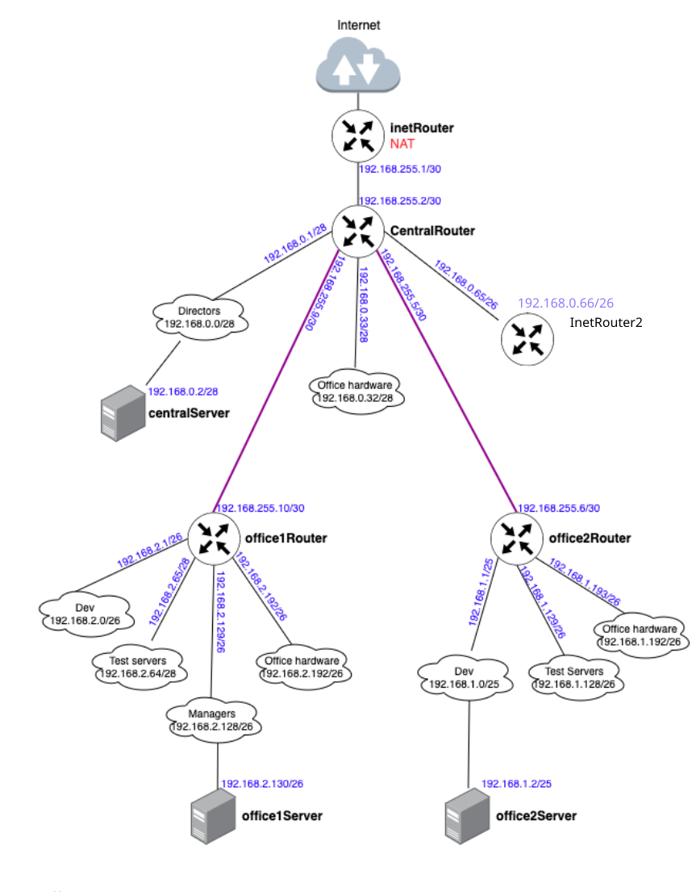

# iptables

## Цель:
Написать сценарии iptables.
### Задачи:

1. реализовать knocking port
2. centralRouter может попасть на ssh inetrRouter через knock скрипт
3. добавить inetRouter2, который виден(маршрутизируется (host-only тип сети для виртуалки)) с хоста или форвардится порт через локалхост.
4. запустить nginx на centralServer.
5. пробросить 80й порт на inetRouter2 8080.
6. дефолт в инет оставить через inetRouter.

#### Схема сети:




```
iptables -t nat -A PREROUTING -i eth1 -p tcp --dport 8080 -j DNAT --to-destination 192.168.0.2:80
iptables -t nat -A POSTROUTING -o eth1 -p tcp -d 192.168.0.2 --dport 80 -j MASQUERADE
```

```
iptables -A INPUT -m conntrack --ctstate ESTABLISHED,RELATED -j ACCEPT
iptables -A INPUT -i lo -j ACCEPT
iptables -A INPUT -p tcp --dport 6222 -m recent --name KNOCK --set -j DROP
iptables -A INPUT -p tcp --dport 22 -m conntrack --ctstate NEW \
  -m recent --name KNOCK --rcheck --seconds 10 -j ACCEPT
iptables -A INPUT -p tcp --dport 22 -j DROP
```
