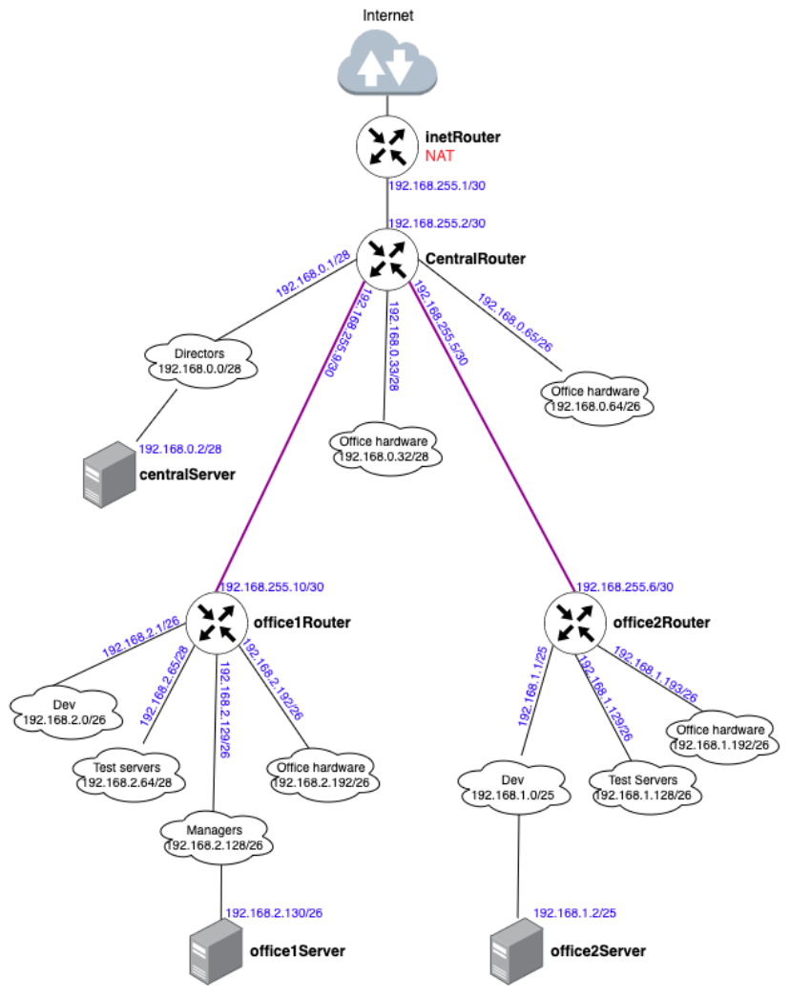

# Настройка сети
## Цель
 - Научится менять базовые сетевые настройки в Linux-based системах.
### В теоретическая часть: 
1) Найти свободные подсети
2) Посчитать количество узлов в каждой подсети, включая свободные
3) Указать Broadcast-адрес для каждой подсети
4) Проверить, нет ли ошибок при разбиении

### Практическая чать: 
1) Соединить офисы в сеть согласно логической схеме и настроить роутинг
2) Интернет-трафик со всех серверов должен ходить через inetRouter
3) Все сервера должны видеть друг друга (должен проходить ping)
4) У всех новых серверов отключить дефолт на NAT (eth0), который vagrant поднимает для связи
5) Добавить дополнительные сетевые интерфейсы, если потребуется

-------------------------------------------------------------------------------------------------------------------------------------------------------------

#### Схема сети: 





Сводная таблица занятых/свободных подсетей:

| name               | network       |  mask         | host min           | host max     | N | broadcast    |
|----   | -------  | ------ | -------  | -------- | -- | --------|
| inet-central<br>| 192.168.255.0/30| 255.255.255.252 | 192.168.255.1 | 192.168.255.2   | 2  | 192.168.255.3 |
| CentralRouter<br>  | 192.168.255.4/30   | 255.255.255.252 | 192.168.255.5 | 192.168.255.6   |  2   | 192.168.255.7  |
|  CentralRouter<br>               |  192.168.255.8/30  |  255.255.255.252 |  192.168.255.9 | 192.168.255.10    | 2  | 192.168.255.11 |  
|  free               |   192.168.255.12/30|   255.255.255.252 | 192.168.255.13 | 192.168.255.14   | 2   | 192.168.255.15 |
|      free              |   192.168.255.16/28 | 255.255.255.240  | 192.168.255.17 |  192.168.255.30  | 14 |  192.168.255.31|  
|      free              |   192.168.255.32/27| 255.255.255.224   | 192.168.255.33 | 192.168.255.62 | 30  |  192.168.255.63  | 
|       free             | 192.168.255.64/26  | 255.255.255.192| 192.168.255.65 | 192.168.255.126     |  62  | 192.168.255.127 |
|     free               |  192.168.255.128/25   | 255.255.255.128 |  192.168.255.129| 192.168.255.254  |  126  |   192.168.255.255              | 
|  centralServer              |   192.168.0.0/28 |     255.255.255.240             |   192.168.0.1             |     192.168.0.14              |  14  |      192.168.0.15          |     
|   free              | 192.168.0.16/28 |    255.255.255.240 |        192.168.0.16 |      192.168.0.30              |   14 |      192.168.0.31           |              
|   OfficeHardware              |      192.168.0.32/28  | 255.255.255.240  |    192.168.0.33            |     192.168.0.46               |  14  |        192.168.0.47         |              
|     free              |   192.168.0.48/28 |   255.255.255.240   |   192.168.0.49             |     192.168.0.62              |  14  |      192.168.0.63             |              
|    free               |  192.168.0.64/26  |  255.255.255.192   |   192.168.0.65             |       192.168.0.126             |   62 |           192.168.0.127     |              
|     free              |  192.168.0.128/25  |  255.255.255.128  |  192.168.0.129              |    192.168.0.254               |  128  |     192.168.0.255           |  
|   office1  |192.168.2.0/26 | 255.255.255.192 | 192.168.2.1 | 192.168.2.62  | 62 | 192.168.2.63|
|  office1  |192.168.2.64/28 |255.255.255.240 |192.168.2.65 | 192.168.2.78 | 14 |  192.168.2.79|
|free	      | 192.168.2.80/28 |	255.255.255.240	| 192.168.2.81 |	192.168.2.94	| 14	 | 192.168.2.95|
|free       |	192.168.2.96/27|	255.255.255.224	|192.168.2.97	|192.168.2.126	|30	|192.168.2.127|
|office1	   |192.168.2.128/26|255.255.255.192	|192.168.2.129	|192.168.2.190	|62	|192.168.2.191|
|office1   |	192.168.2.192/26	|255.255.255.192	|192.168.2.193|	192.168.2.254	|62	| 192.168.2.255|
|office2|192.168.1.0/25	|255.255.255.128|	192.168.1.1	|192.168.1.126	|126	|192.168.1.127|
|office2	|192.168.1.128/26|	255.255.255.192	|192.168.1.129	|192.168.1.190	|62	|192.168.1.191|
|office2	|192.168.1.192/26	|255.255.255.192	|192.168.1.193	|192.168.1.254	|62	|192.168.1.255|


#### Настроим маршруты и nat на inet router. 

**Настроим Nat:**

/etc/iptables_rules.ipv4

```
# Generated by iptables-save v1.8.7 on Thu Nov  5 08:39:53 2026
*nat
:PREROUTING ACCEPT [0:0]
:INPUT ACCEPT [0:0]
:OUTPUT ACCEPT [0:0]
:POSTROUTING ACCEPT [0:0]
-A POSTROUTING ! -d 192.168.0.0/16 -o eth0 -j MASQUERADE
COMMIT
# Completed on Thu Nov  5 08:39:53 2026

```

Создадим файл, в который добавим скрипт автоматического восстановления правил при перезапуске системы:
vi /etc/network/if-pre-up.d/iptables

```
#!/bin/sh
/sbin/iptables-restore < /etc/iptables_rules.ipv4
```

**Настроим маршруты в /etc/netplan:**

inet router:

```
---
network:
  version: 2
  renderer: networkd
  ethernets:
    eth1:
      addresses:
      - 192.168.255.1/30
      routes:
      - to: 192.168.0.0/16
        via: 192.168.255.2
    eth2:
      addresses:
      - 192.168.50.10/24
```

central router:

```
network:
  version: 2
  renderer: networkd
  ethernets:
    eth1:
      addresses:
      - 192.168.255.2/30
      routes:
      - to: 0.0.0.0/0
        via: 192.168.255.1
    eth2:
      addresses:
      - 192.168.0.1/28
    eth3:
      addresses:
      - 192.168.0.33/28
    eth4:
      addresses:
      - 192.168.0.65/26
    eth5:
      addresses:
      - 192.168.255.9/30
      routes:
      - to: 192.168.2.0/26
        via: 192.168.255.10

      - to: 192.168.2.64/28
        via: 192.168.255.10

      - to: 192.168.2.128/26
        via: 192.168.255.10

      - to: 192.168.2.192/26
        via: 192.168.255.10
    eth6:
      addresses:
      - 192.168.255.5/30
      routes:
      - to: 192.168.1.192/26
        via: 192.168.255.6

      - to: 192.168.1.128/26
        via: 192.168.255.6

      - to: 192.168.1.0/25
        via: 192.168.255.6
    eth7:
      addresses:
      - 192.168.50.11/24
```

Остальным достаточно прописать default gw в сторону CentralRouter.


