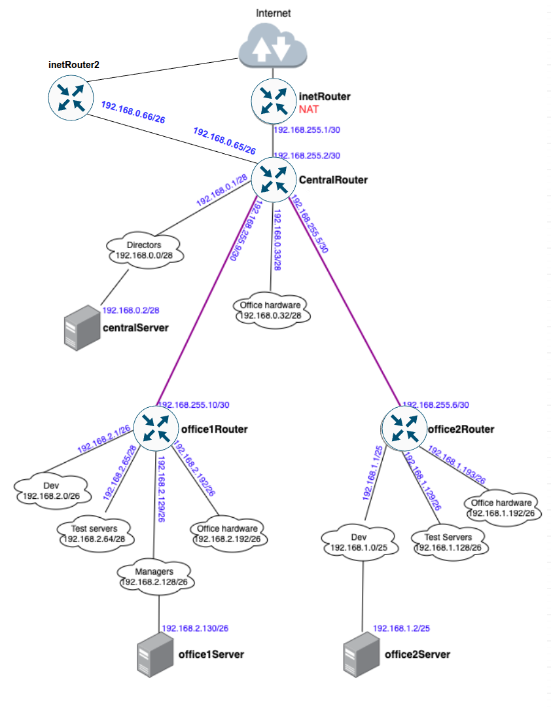

# OSPF
## Цель
Создать домашнюю сетевую лабораторию. Научится настраивать протокол OSPF в Linux-based системах.

### Задачи

1. Развернуть 3 виртуальные машины
2. Объединить их разными vlan
- настроить OSPF между машинами на базе Quagga;
- изобразить ассиметричный роутинг;
- сделать один из линков "дорогим", но что бы при этом роутинг был симметричным.

---------------------------------------------------------------------------

#### Схема сети:



#### Ассиметричный роутинг:
Нужно увеличить ospf cost на линке с одной стороны, тогда трафик к узлу и обратно будет ходить по разным путям. 
Например увеличим ospf cost на router1 в сторону router3.
Проверим результат:

```
vagrant@router3:~$ traceroute 192.168.10.1
traceroute to 192.168.10.1 (192.168.10.1), 30 hops max, 60 byte packets
 1  192.168.10.1 (192.168.10.1)  1.151 ms  0.699 ms  0.637 ms
vagrant@router3:~$ 
```

```
vagrant@router1:~$ traceroute 192.168.30.1
traceroute to 192.168.30.1 (192.168.30.1), 30 hops max, 60 byte packets
 1  10.0.11.2 (10.0.11.2)  0.633 ms  0.601 ms  0.587 ms
 2  192.168.30.1 (192.168.30.1)  0.573 ms  0.556 ms  0.555 ms
vagrant@router1:~$ 
```

```
vagrant@router1:~$ sudo tcpdump -i any -p icmp
tcpdump: data link type LINUX_SLL2
tcpdump: verbose output suppressed, use -v[v]... for full protocol decode
listening on any, link-type LINUX_SLL2 (Linux cooked v2), snapshot length 262144 bytes
11:27:20.046213 eth1  Out IP router1 > 192.168.30.1: ICMP echo request, id 14, seq 1, length 64
11:27:20.046709 eth2  In  IP 192.168.30.1 > router1: ICMP echo reply, id 14, seq 1, length 64
11:27:21.086333 eth1  Out IP router1 > 192.168.30.1: ICMP echo request, id 14, seq 2, length 64
11:27:21.086841 eth2  In  IP 192.168.30.1 > router1: ICMP echo reply, id 14, seq 2, length 64
11:27:22.118118 eth1  Out IP router1 > 192.168.30.1: ICMP echo request, id 14, seq 3, length 64
11:27:22.119165 eth2  In  IP 192.168.30.1 > router1: ICMP echo reply, id 14, seq 3, length 64
11:27:23.138773 eth1  Out IP router1 > 192.168.30.1: ICMP echo request, id 14, seq 4, length 64
11:27:23.140205 eth2  In  IP 192.168.30.1 > router1: ICMP echo reply, id 14, seq 4, length 64
11:27:24.171072 eth1  Out IP router1 > 192.168.30.1: ICMP echo request, id 14, seq 5, length 64
11:27:24.172551 eth2  In  IP 192.168.30.1 > router1: ICMP echo reply, id 14, seq 5, length 64
11:27:25.195242 eth1  Out IP router1 > 192.168.30.1: ICMP echo request, id 14, seq 6, length 64
11:27:25.196689 eth2  In  IP 192.168.30.1 > router1: ICMP echo reply, id 14, seq 6, length 64
11:27:26.198727 eth1  Out IP router1 > 192.168.30.1: ICMP echo request, id 14, seq 7, length 64
11:27:26.200215 eth2  In  IP 192.168.30.1 > router1: ICMP echo reply, id 14, seq 7, length 64
^C
14 packets captured
16 packets received by filter
0 packets dropped by kernel
vagrant@router1:~$ 
```
